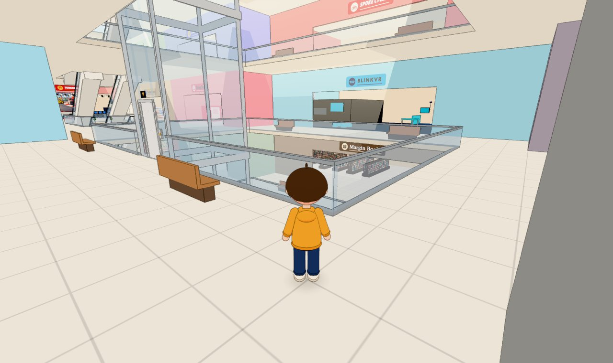
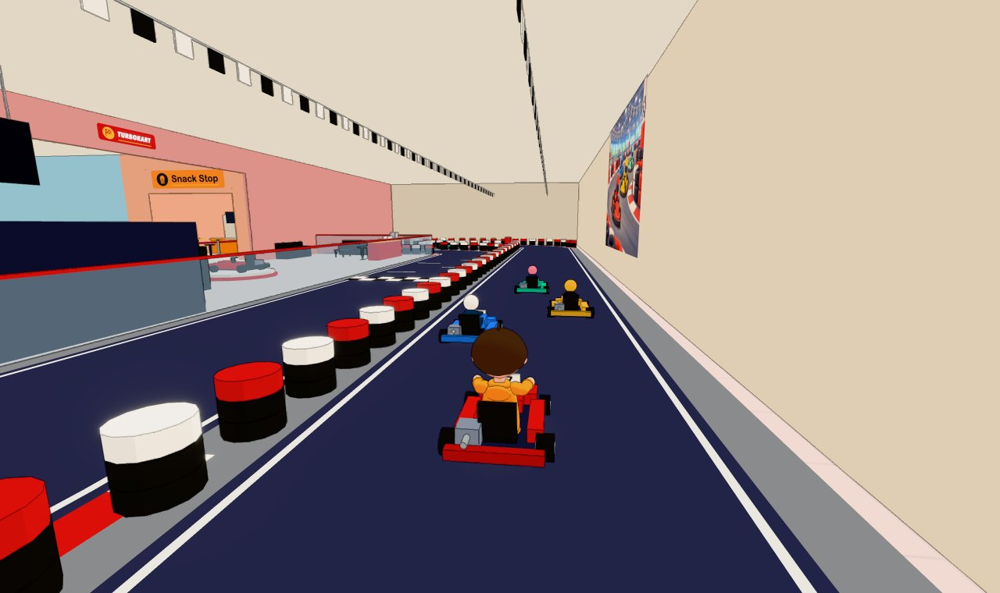
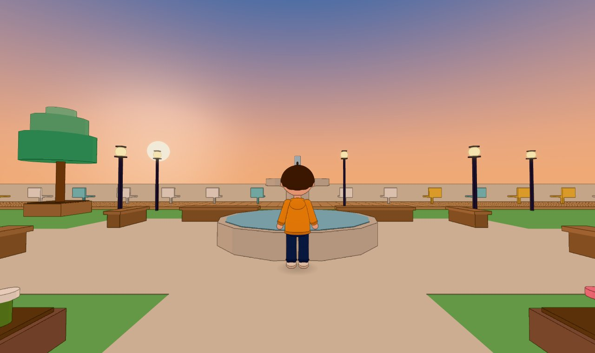
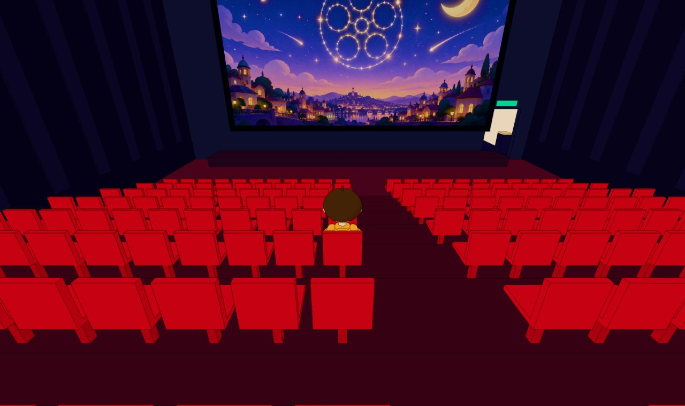
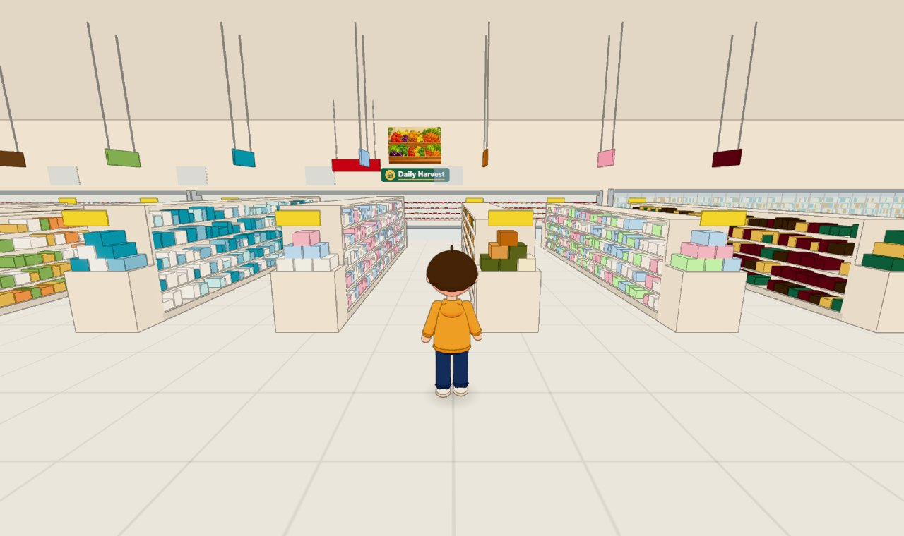
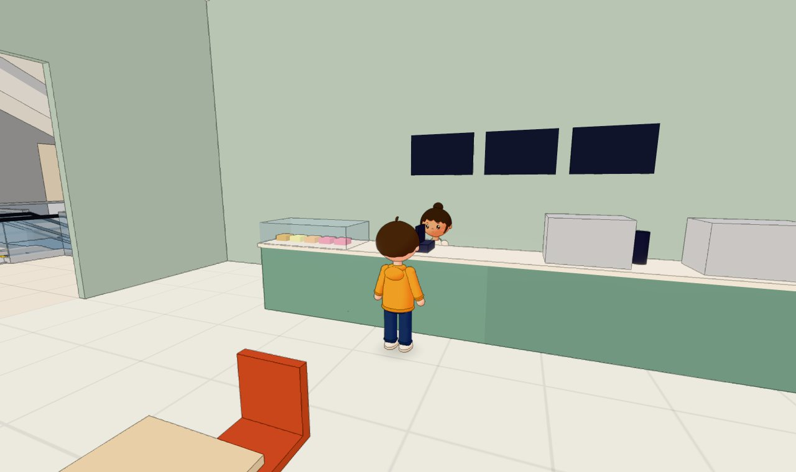
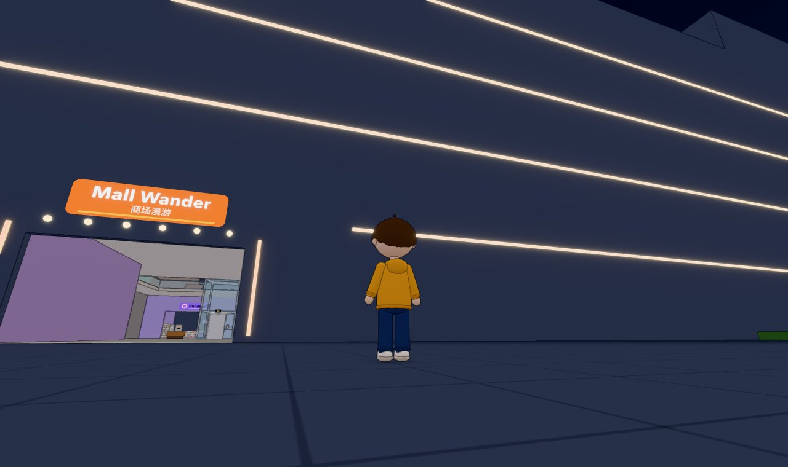

<div align="center">

# Mall Wander · 商场漫游

**A cozy cartoon shopping mall you can wander around in your browser.**

B1 + 1F–5F · 56 shops · talking shop staff · day and night · sky garden · cinema · go-karts

### [▶ Play now](https://roycebella-commits.github.io/supermarket/)

No install, no account. Open the page and start walking.

[简体中文](./README.md) · English



</div>

---

## A look inside

<table>
  <tr>
    <td width="50%"><br><b>TurboKart</b>: rent a kart and race three AI drivers</td>
    <td width="50%"><br><b>Skyline Garden</b>: an open-air rooftop garden on 5F, best at sunset</td>
  </tr>
  <tr>
    <td><br><b>Starlight Cinema</b>: a 220-seat hall that plays your own videos</td>
    <td><br><b>Daily Harvest</b>: the B1 supermarket with produce, grocery aisles and fresh food</td>
  </tr>
  <tr>
    <td><br>21 shop staff to chat with: walk up and press <code>E</code></td>
    <td><br>A full day takes about 20 minutes; the facade lights up at night</td>
  </tr>
</table>

---

## What can you do here?

There are no quests and nothing to "beat". You can just wander:

- Explore six floors (B1 to 5F) and 56 shops of all kinds
- Ride the escalators, or take the glass elevator in the central atrium
- Chat with the staff of 21 main shops (fully voiced in Mandarin, with English subtitles)
- Sit down anywhere: benches, café chairs, sofas, garden loungers — every chair works
- Watch the mall drift from daytime into sunset and night
- Rent a go-kart at **TurboKart** on 3F and chase the lap record
- Play a video from your own computer on the big screen at **Starlight Cinema** on 5F
- Watch the sunset, the fountain and the evening lanterns at **Skyline Garden** on 5F
- Listen to the built-in music, or drop in your own songs for this session
- Hear the occasional mall announcement: a chime, then a voice with captions

It's meant to be a place to hang out in, not a map to clear.

> **Language:** the interface starts in Chinese. Press `L`, or click **中 / EN** on the start screen, to switch to English. Staff voices stay in Mandarin; subtitles follow the interface language.

## Suggested first walk

**1F main entrance → central atrium → up the escalators → 3F TurboKart → 5F Starlight Cinema → 5F Skyline Garden**

If it's close to sunset, linger in the garden. Can't wait? Press `M` and drag the clock to the evening.

---

## Three places worth a visit

### 🏎️ TurboKart · 3F west

Walk up to the sign-up kiosks next to the front desk and press `E`. After a 3-2-1 countdown, you're off.

- `W` / `S`: throttle / brake (hold `S` after stopping to reverse)
- `A` / `D`: steer. Steering gets heavier at speed, so lift off before the corners
- `R`: put the kart back on the track if you get stuck
- `E`: get out and return to the lobby

Timing starts when you first cross the start line. The top of the screen shows your current, last and best lap. Your best lap is saved in your browser and appears on the leaderboard screen above the front desk.

Three AI drivers — Mika, Kenta and Lena — lap the track, follow each other and overtake. Catch one from behind and it will make room for you.

### 🎬 Starlight Cinema · 5F east

The lobby has ticket machines, a box office, a concession stand, a merch shop, a waiting area and a ticket gate. Beyond it is a **220-seat stadium hall**.

Stand in front of the screen, press `E`, and pick a video file from your computer: it plays on the big screen. Sound comes from the screen and the background music fades down. Take a seat and press `P` to pause or resume.

Your video is read locally by your browser and **never uploaded anywhere**. MP4 (H.264) and WebM work best; unsupported formats show a message.

### 🌇 Skyline Garden · 5F west

A real outdoor space: a fountain plaza, lawns and picnic tables, a vine pergola, a vegetable patch, a greenhouse, and a sunset deck with loungers. Grandpa Tao, the gardener, is by the seedling table if you want a chat.

The light turns warm at sunset, and the lanterns come on after dark.

---

## Controls

| Key | Action |
|---|---|
| `W` `A` `S` `D` / arrow keys | Move |
| `Shift` | Run |
| `Space` | Jump |
| Mouse | Look around (click the game first) |
| `E` | Interact: talk, sit / stand, call the elevator, choose a floor, cinema panel, rent / leave a kart |
| `V` | Switch first / third person |
| Mouse wheel | Third-person camera distance |
| `M` | Music panel (also game clock and announcements on/off) |
| `P` | Pause / resume the movie in the cinema hall |
| `R` | Reset your kart onto the track |
| `L` | Chinese / English |
| `Esc` | Pause and release the mouse |

Inside the elevator, press `E` for the floor panel, or press `1`–`5` or `B` to pick a floor directly.

---

## Music, announcements and time

- One in-game day lasts about 20 real minutes. The sky, sun, stars, skylight beams and night lights all follow the clock.
- In the music panel you can drag or freeze the clock. The time is saved in your browser and keeps going next visit.
- A mall announcement plays every seven or eight minutes, plus special ones for morning, sunset, nightfall and cinema showtimes. You can turn them off in the music panel.
- Announcements wait while a staff member is talking, and never interrupt a movie in the cinema hall.
- The built-in soundtrack on the web version is Bach's *Goldberg Variations* played by Kimiko Ishizaka (CC0 / public domain).
- You can also import your own songs in the music panel (or drag them into the window) to play alongside the built-in tracks. They only last for the current session and are never uploaded.

---

## Devices and browsers

- **Recommended:** a computer with keyboard and mouse, and the latest Chrome or Edge.
- The game is mainly tested in Chrome. Safari, Firefox and other browsers haven't been fully tested and may have small issues.
- Phones and tablets aren't supported yet (no touch controls).
- WebGL and hardware acceleration need to be enabled.

---

## FAQ

<details>
<summary><b>There's no sound.</b></summary>

Browsers only allow audio after a click. Click **Click to start** on the start screen and the music begins. You can also press `M` to check the volume.
</details>

<details>
<summary><b>My mouse is "stuck" in the game.</b></summary>

After you click the game, the mouse controls the camera. Press `Esc` to release it, and click the game again to continue.
</details>

<details>
<summary><b>It runs slowly.</b></summary>

- Close other tabs or programs that use the graphics card
- Make sure hardware acceleration is turned on in your browser
- Add `?nofx` to the address to turn off outlines and bloom: <https://roycebella-commits.github.io/supermarket/?nofx>
</details>

<details>
<summary><b>The first load takes a while.</b></summary>

The first visit downloads models, textures and music, so give it a moment on a slow connection. Staff models and voices only load when you walk near them.
</details>

<details>
<summary><b>Where is my progress saved?</b></summary>

Your language, game clock, best lap, announcement setting and so on are stored in your own browser — no account needed. Another browser, or clearing site data, starts fresh.
</details>

<details>
<summary><b>Are my videos and songs uploaded?</b></summary>

No. They're read and played only inside your browser, and they're gone when you close the page.
</details>

---

<details>
<summary><strong>For developers / running locally</strong></summary>

### Tech stack

Vite · TypeScript · Three.js · Rapier · three-vrm · postprocessing

### Run locally

Node.js 24 is recommended (Vite needs Node.js 20.19+ or 22.12+).

```bash
npm install
npm run dev
```

Then open <http://127.0.0.1:5173/> in Chrome.

```bash
npm run typecheck
npm run build
npm run preview
```

### Windows

Double-click `start.cmd` in the project root. It starts the dev server and opens your browser.

On first run it downloads a project-local Node.js 24.21.0 from nodejs.org (checksum verified) and installs the Windows dependencies from the lockfile. Everything goes into `.runtime/`; your system PATH is untouched and no admin rights are needed.

- `setup.cmd`: set up or reinstall dependencies on their own
- Close the window or press `Ctrl+C` to stop the server
- Build: `powershell -NoProfile -ExecutionPolicy Bypass -File tools/windows.ps1 -Action build` (use `typecheck` or `preview` in place of `build` for those)

Python, ffmpeg and the local voice model are only needed to regenerate assets, not to run the game.

### Switching between macOS and Windows

`node_modules` contains platform-specific native packages. If you use the same project folder (for example on an external drive) on both systems:

- On Windows, `start.cmd` notices and reinstalls automatically.
- On macOS, if startup fails with `Cannot find native binding`, run `npm ci` once.

### GitHub Pages

Every push to `main` triggers GitHub Actions to install, type-check, build and deploy the online version. For the first deploy, set `Settings → Pages → Source` to `GitHub Actions`.

The online build only ships music that can be published; the developer's commercial local track is not in the repository.

### Debug URL parameters

| Parameter | Effect |
|---|---|
| `?debug` | Collision wireframes, FPS, draw calls, coordinates |
| `?map` | Floor plan of the current floor with your position |
| `?floor=3` | Start on a floor (`1`–`5`, or `B1`) |
| `?shop=turbokart` | Start at a shop's entrance (ids in `src/data/mallLayout.ts`) |
| `?view=first` | Start in first person |
| `?nofx` | Turn off outlines and bloom |
| `?testbed` | Load the movement test level |
| `?bgmSeek=-5` | Start the BGM 5 s before its loop point |

Parameters can be combined, e.g. `?debug&map&floor=5`. The console exposes test hooks on `window.__game`; `window.__game.stats()` reports draw calls, triangles and render time.

### Project layout

```text
src/data/      layout, avatar specs, staff and announcement lines
src/world/     building, stairs, escalators, elevator, signs, shop interiors
src/npc/       staff loading, gaze and conversations
src/player/    input, character controller, VRM, animation, camera
src/systems/   physics, interaction, seats, audio, announcements, cinema, karting
src/render/    toon rendering, post-processing, day cycle and sky
src/ui/        HUD, panels, dialogue box, Chinese / English UI
tools/         offline asset pipelines (audio, VRM, voice, decor images)
docs/          interior design references, screenshots
```

</details>

---

## Credits and notes

- All shop names, signs and logos are original and fictional; they don't represent any real brand.
- The player and staff characters are original VRM models generated from code.
- Staff and announcer voices were generated with a local text-to-speech model from written voice descriptions; they don't imitate any real person.
- The decorative illustrations were generated for this project and contain no text, trademarks or real brands.
- Full asset sources are listed in [CREDITS.md](./CREDITS.md) (in Chinese).

---

<div align="center">

**Mall Wander is still growing.**

No need to read the manual first.

**[Just open the page and take a walk.](https://roycebella-commits.github.io/supermarket/)**

</div>
